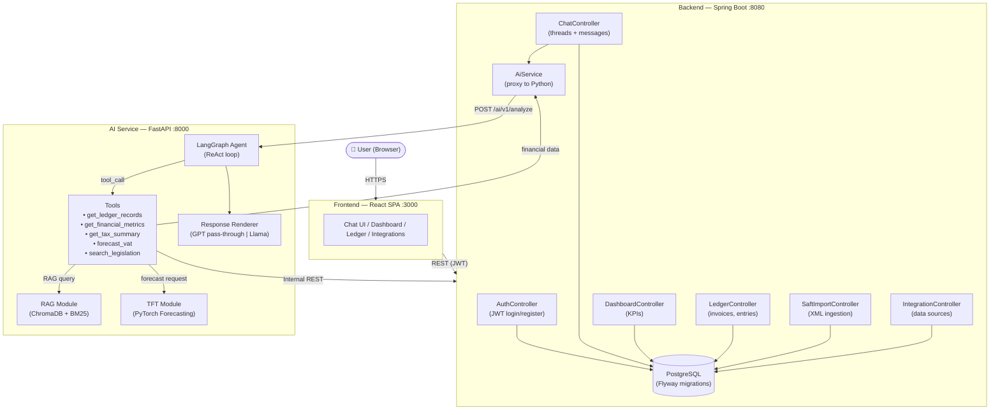
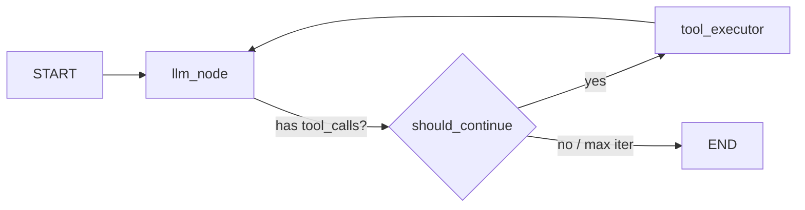
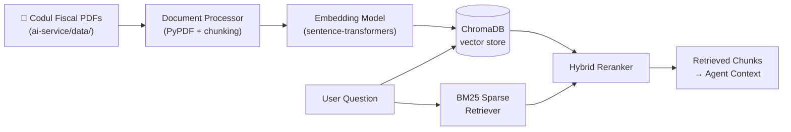
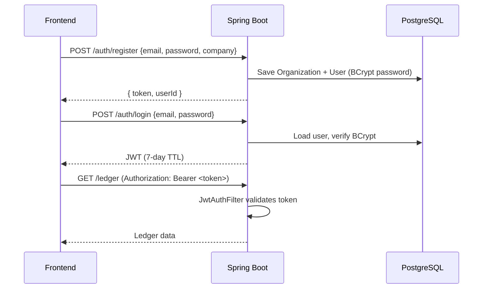
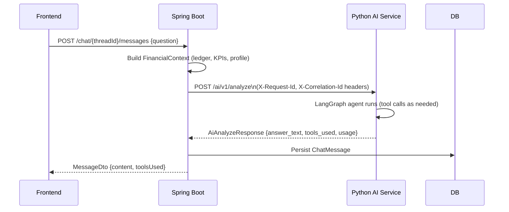

# 🧠 Financial Copilot

**An AI-powered financial advisor for SMEs** — ask questions about your company's finances in plain language and get instant, grounded answers backed by your real ledger data, Romanian tax law, and ML-powered VAT forecasting.

> Built as a Bachelor's Degree project in Computer Science.

---

## 📸 Overview

Financial Copilot is a full-stack, multi-service application that combines:

- A **React + TypeScript** SPA with a chat interface and financial dashboard
- A **Spring Boot** backend that manages users, ledger data, SAF-T imports, and AI orchestration
- A **Python FastAPI** AI agent powered by **LangGraph** with tool-calling capabilities
- A **RAG pipeline** over Romanian fiscal legislation (Codul Fiscal)
- A **TFT (Temporal Fusion Transformer)** model for VAT/cash-flow forecasting
- **PostgreSQL** as the single source of truth, managed by Flyway migrations
- Full **Docker Compose** deployment

---

## 🗂️ Repository Structure

```
ProjectFinancialCopilot/
├── frontend/               # React 19 + TypeScript + Tailwind v4 SPA
├── backend/                # Spring Boot 3.4 REST API + JPA + Security
├── ai-service/             # Python FastAPI — LangGraph agent + RAG + TFT
│   ├── agent/              # LangGraph graph, tools, config
│   ├── rag-module/         # ChromaDB ingestion + retrieval pipeline
│   ├── tft_module/         # Temporal Fusion Transformer forecasting
│   ├── renderers/          # Pluggable LLM response post-processors
│   └── data/               # Romanian fiscal law PDFs (RAG source)
├── infra/                  # Docker Compose + environment templates
├── contracts/              # OpenAPI spec for the internal AI service contract
└── .env.example            # Root environment template (copy → .env)
```

---

## 🏗️ System Architecture



---

## 🤖 AI Agent — Deep Dive

The agent is built on **LangGraph** with a two-node reasoning loop.

### Agent Graph



The `should_continue` router also enforces a hard cap (`MAX_AGENT_ITERATIONS`, default 5) to prevent runaway loops.

### Agent Tools

| Tool | Description | Calls |
|------|-------------|-------|
| `get_ledger_records` | Fetches invoices & journal entries for a date range | Java backend |
| `get_financial_metrics` | Returns computed KPIs: revenue, expenses, profit, cash position | Java backend |
| `get_tax_summary` | Returns VAT, income tax and total tax liability breakdown | Java backend |
| `forecast_vat` | Runs the TFT model to predict future monthly VAT obligations | Python (TFT module) |
| `search_legislation` | Semantic + BM25 hybrid search over Romanian Codul Fiscal PDFs | Python (RAG module) |

### RAG Pipeline



Run ingestion once before starting the agent:
```bash
cd ai-service/rag-module
python ingest.py
```

### TFT Forecasting Module

The **Temporal Fusion Transformer** (`tft_module/`) is trained on a synthetic Romanian financial dataset and predicts `monthly_vat_target` 1 month ahead using:

- **Static categoricals**: business sector
- **Time-varying known**: month, quarter, day-of-week, holiday flag, macro index
- **Time-varying unknown**: revenue, expenses, profit, VAT due, tax due

The forecast tool is called by the agent when the user asks questions like *"What will my VAT be next month?"*

---

## 🗄️ Backend — Deep Dive

Built with **Spring Boot 3.4**, **Java 21**, **Spring Data JPA**, and **Spring Security**.

### Key Domain Areas

| Package | Responsibility |
|---------|---------------|
| `controller/` | REST endpoints (Auth, Chat, Dashboard, Ledger, SAF-T, Integrations) |
| `service/` | Business logic, AI orchestration, ledger aggregation, reconciliation |
| `entity/` | JPA entities: Users, Organizations, ChatThreads, Invoices, JournalEntries, Payments… |
| `security/` | JWT filter, `JwtService`, `SecurityConfig` |
| `dto/saft/` | Jackson XML mapping for SAF-T (Standard Audit File for Tax) |
| `integration/` | Adapter stubs for SmartBill, FGO, Tink, SAF-T connectors |

### Authentication Flow



### Chat → AI Flow



### SAF-T Import

The backend can parse **SAF-T XML** files (Romanian standard for accounting data exchange). Importing a SAF-T file populates the ledger with:
- Chart of accounts
- Customers and suppliers (counterparties)
- Sales and purchase invoices
- General ledger journal entries
- Tax codes

Upload via: `POST /api/saft/upload` (multipart XML)

---

## 💻 Frontend — Deep Dive

Built with **React 19**, **TypeScript**, **Vite 5**, and **Tailwind CSS v4**.

### Pages

| Page | Route | Description |
|------|-------|-------------|
| Login | `/login` | JWT-based authentication |
| Register | `/register` | Company + user registration |
| Dashboard | `/dashboard` | KPI cards, revenue/expense charts, AI chat sidebar |
| Ledger | `/ledger` | Invoice list with filtering and payment status |
| Integrations | `/integrations` | Connect data sources (SAF-T, SmartBill, FGO, Tink) |
| Profile | `/profile` | Company profile management |

### Component Architecture

```
src/
├── App.tsx                 # Router setup
├── main.tsx                # React root + auth context
├── api/                    # Typed fetch wrappers per domain
├── auth/                   # Auth context + protected route HOC
├── components/
│   ├── Chat.tsx            # Full chat interface with streaming display
│   ├── Dashboard.tsx       # KPI dashboard with charts
│   └── DashboardCard.tsx   # Reusable KPI card
├── layout/                 # App shell, navbar, sidebar
├── pages/                  # Page-level components
└── types/                  # Shared TypeScript interfaces
```

---

## 🚀 Running Locally

### Prerequisites

| Tool | Version |
|------|---------|
| Docker + Docker Compose | v2+ |
| Node.js | ≥ 20.19 (frontend dev only) |
| Python | 3.11+ (ai-service dev only) |
| Java | 21 (backend dev only) |
| OpenAI API Key | Required for the agent |

---

### Option 1 — Full Stack with Docker Compose (recommended)

```bash
# 1. Clone the repo
git clone https://github.com/your-org/financial-copilot.git
cd financial-copilot

# 2. Configure environment
cp .env.example infra/.env
# Edit infra/.env and set OPENAI_API_KEY

# 3. (First time only) Ingest the RAG documents
cd ai-service/rag-module
pip install -r ../requirements.txt
python ingest.py
cd ../..

# 4. Start all services
cd infra
docker compose up --build
```

Services will be available at:

| Service | URL |
|---------|-----|
| Frontend | http://localhost:3000 |
| Backend API | http://localhost:8080 |
| AI Service | http://localhost:8000 |
| PostgreSQL | localhost:5432 |

---

### Option 2 — Individual Services (development)

#### Backend (Spring Boot)

```bash
cd backend

# Requires PostgreSQL on localhost:5432 (use Docker for just the DB)
docker run -d --name pg \
  -e POSTGRES_DB=copilot -e POSTGRES_USER=copilot -e POSTGRES_PASSWORD=copilot \
  -p 5432:5432 postgres:16

./mvnw spring-boot:run
# API available at http://localhost:8080
```

#### AI Service (Python)

```bash
cd ai-service

python -m venv venv && source venv/bin/activate
pip install -r requirements.txt

# Copy and fill in env
cp ../.env.example .env
# Set OPENAI_API_KEY and JAVA_BACKEND_URL=http://localhost:8080

# (First time) Ingest RAG documents
cd rag-module && python ingest.py && cd ..

uvicorn agent.api:app --reload --port 8000
# API docs at http://localhost:8000/docs
```

#### Frontend (React)

```bash
cd frontend
npm install
npm run dev
# SPA at http://localhost:5173
```

---

## 🔑 Environment Variables

Copy `.env.example` to `.env` (or `infra/.env` for Docker Compose) and fill in your values.

| Variable | Required | Default | Description |
|----------|----------|---------|-------------|
| `OPENAI_API_KEY` | ✅ | — | Your OpenAI API key |
| `OPENAI_MODEL` | | `gpt-4o-mini` | Model to use for the agent |
| `LLM_TEMPERATURE` | | `0.2` | LLM sampling temperature |
| `LLM_MAX_TOKENS` | | `2000` | Max response tokens |
| `MAX_AGENT_ITERATIONS` | | `5` | Max LangGraph reasoning steps |
| `JAVA_BACKEND_URL` | | `http://localhost:8080` | Backend URL (from AI service) |
| `RESPONSE_RENDERER` | | `gpt_only` | `gpt_only` or `llama_post_process` |
| `OLLAMA_URL` | | `http://localhost:11434` | Ollama URL (if using Llama renderer) |
| `OLLAMA_MODEL` | | `llama3` | Ollama model name |
| `OLLAMA_TIMEOUT` | | `10` | Ollama request timeout (seconds) |
| `SPRING_FLYWAY_VALIDATE_ON_MIGRATE` | | `false` | Flyway schema validation |
| `JWT_SECRET` | | dev default | JWT signing secret (change in production!) |

---

## 🛡️ Design Decisions

### Advisory-Only AI
The AI service is **strictly read-only** — it has no database access and cannot mutate any state. All write operations go through the Spring Boot backend. This is enforced via the `AiConstraints.advisory_only = true` field in every request and documented in `contracts/internal-ai.openapi.yaml`.

### Internal API Contract
The Java backend and Python AI service communicate via a versioned internal OpenAPI contract (`contracts/internal-ai.openapi.yaml`). This ensures both sides agree on request/response shapes independently of implementation language.

### Multi-tenant Architecture
Every entity in the database is scoped to an `Organization`. JWT tokens carry the `organizationId` claim, which is validated at the service layer so users can only ever see their own company's data.

### Pluggable Response Rendering
After the agent produces an answer, it passes through a **renderer** (`renderers/`). The default `gpt_only` renderer is a pass-through. Optionally, `llama_post_process` sends the text to a local Ollama/Llama instance for stylistic post-processing — useful for matching a specific tone without re-running the full expensive agent call.

---

## 📦 Tech Stack Summary

| Layer | Technology |
|-------|-----------|
| Frontend | React 19, TypeScript, Vite 5, Tailwind CSS v4 |
| Backend | Spring Boot 3.4, Java 21, Spring Security, Flyway |
| AI Agent | Python 3.11, FastAPI, LangGraph, LangChain, OpenAI |
| RAG | ChromaDB, sentence-transformers, BM25 (rank-bm25), PyPDF |
| Forecasting | PyTorch Forecasting (TFT), PyTorch Lightning, pandas |
| Database | PostgreSQL 16 |
| Infra | Docker, Docker Compose, nginx (frontend) |
| Auth | JWT (jjwt 0.12), BCrypt |

---

## 📄 License

This project was developed as a Bachelor's thesis project. All rights reserved.
